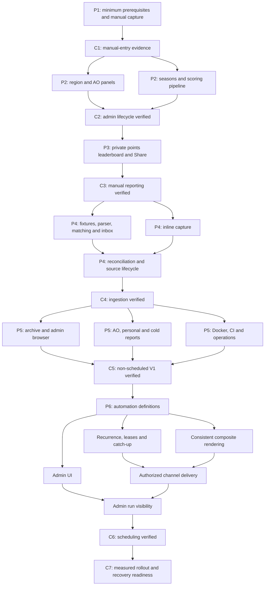

# Implementation plan: F3 Yeti Man — V1

Status: task breakdown requested by the user; no application implementation or production rollout performed.

Source: [V1 specification](../docs/spec/README.md), merged in [PR #1](https://github.com/abobwhite/f3-yeti-man/pull/1). Task list target: **GitHub Issues** in `abobwhite/f3-yeti-man`; do not create a duplicate `tasks/todo.md` checklist. The [spec task index](../docs/spec/implementation-tasks.md) and per-module tables link requirements back to issues.

## Architecture and delivery constraints

- Keep the five approved modules and one-way provider dependencies. Entries own competition facts; workouts remain external F3 Nation references. V1 observes Slack messages and does not call a presumed F3 API.
- Use the confirmed Node.js/TypeScript/Bolt/official MongoDB driver direction and the balanced compiler/test/command contract. The repository starts with specifications only; proposed paths in issues are target paths.
- Validate the minimum admin-confirmed setup, region isolation, real MongoDB transactions, duplicate identity and season/config fences before any live manual capture. Avoid building the complete admin/automation systems as early prerequisites.
- Preserve user priority: manual capture -> full admin configuration -> manual total-points reporting -> source ingestion/inline capture -> remaining V1 -> scheduled reports. Checkpoints are completion prerequisites between these priorities.
- One portable always-running Docker service on DigitalOcean App Platform with managed MongoDB serves isolated regions. Start around the dated $25/month estimate, measure the selected plan, deploy passing main revisions automatically and roll back code independently from data.
- Indefinite competition/audit retention is distinct from temporary UI state and backup retention. Operating targets are <=24 hours of lost changes and restoration within one business day, proved by a timed isolated restore.

## Task list and dependency graph

The ordered issue index below is the plan’s task list. Each issue has three concrete acceptance criteria, verification steps, likely files (at most five), spec IDs and direct reciprocal issue links. There are 54 implementation tasks, 7 checkpoints and 79 direct dependency edges.

This diagram summarizes the lanes; the following direct-blocker index and issue bodies are the complete task-level graph.

### Priority 1: Manual entry capture and its minimum prerequisites

| Task / issue | Direct blockers |
|---|---|
| [T01 #2](https://github.com/abobwhite/f3-yeti-man/issues/2): Scaffold the official Bolt starter without overwriting repository content | None |
| [T02 #3](https://github.com/abobwhite/f3-yeti-man/issues/3): Convert the starter to the balanced TypeScript build contract | [T01 #2](https://github.com/abobwhite/f3-yeti-man/issues/2) |
| [T03 #4](https://github.com/abobwhite/f3-yeti-man/issues/4): Provide the test, coverage, lint and module-check scripts | [T02 #3](https://github.com/abobwhite/f3-yeti-man/issues/3) |
| [T04 #5](https://github.com/abobwhite/f3-yeti-man/issues/5): Support real ephemeral and Docker MongoDB integration modes | [T03 #4](https://github.com/abobwhite/f3-yeti-man/issues/4) |
| [T05 #6](https://github.com/abobwhite/f3-yeti-man/issues/6): Persist encrypted multi-workspace OAuth installations | [T04 #5](https://github.com/abobwhite/f3-yeti-man/issues/5) |
| [T06 #7](https://github.com/abobwhite/f3-yeti-man/issues/7): Enforce signed tenant, member and destination authorization | [T05 #6](https://github.com/abobwhite/f3-yeti-man/issues/6) |
| [T07 #8](https://github.com/abobwhite/f3-yeti-man/issues/8): Build the leased durable-operation and message-outbox runtime | [T06 #7](https://github.com/abobwhite/f3-yeti-man/issues/7) |
| [T08 #9](https://github.com/abobwhite/f3-yeti-man/issues/9): Implement configurable scoring and workout-reference validation | [T03 #4](https://github.com/abobwhite/f3-yeti-man/issues/4) |
| [T09 #10](https://github.com/abobwhite/f3-yeti-man/issues/10): Persist seasons and enforce transactional season write fences | [T04 #5](https://github.com/abobwhite/f3-yeti-man/issues/5), [T06 #7](https://github.com/abobwhite/f3-yeti-man/issues/7), [T08 #9](https://github.com/abobwhite/f3-yeti-man/issues/9) |
| [T10 #11](https://github.com/abobwhite/f3-yeti-man/issues/11): Provide the required setup gate and minimal legitimate admin setup | [T06 #7](https://github.com/abobwhite/f3-yeti-man/issues/7), [T08 #9](https://github.com/abobwhite/f3-yeti-man/issues/9), [T09 #10](https://github.com/abobwhite/f3-yeti-man/issues/10) |
| [T11 #12](https://github.com/abobwhite/f3-yeti-man/issues/12): Save versioned entries atomically with duplicate and retry protection | [T07 #8](https://github.com/abobwhite/f3-yeti-man/issues/8), [T10 #11](https://github.com/abobwhite/f3-yeti-man/issues/11) |
| [T12 #13](https://github.com/abobwhite/f3-yeti-man/issues/13): Publish version-aware saved entry summaries through the outbox | [T11 #12](https://github.com/abobwhite/f3-yeti-man/issues/12) |
| [T13 #14](https://github.com/abobwhite/f3-yeti-man/issues/14): Capture manual entries in private Slack forms | [T12 #13](https://github.com/abobwhite/f3-yeti-man/issues/13) |
| [T14 #15](https://github.com/abobwhite/f3-yeti-man/issues/15): Modify entries privately without replacing the committed public view | [T13 #14](https://github.com/abobwhite/f3-yeti-man/issues/14) |
| [C1 #16](https://github.com/abobwhite/f3-yeti-man/issues/16): Verify the complete manual-entry milestone | [T14 #15](https://github.com/abobwhite/f3-yeti-man/issues/15) |

### Priority 2: Complete admin configurations

| Task / issue | Direct blockers |
|---|---|
| [T15 #17](https://github.com/abobwhite/f3-yeti-man/issues/17): Manage region settings, designated admins and reply mode in App Home | [C1 #16](https://github.com/abobwhite/f3-yeti-man/issues/16) |
| [T16 #18](https://github.com/abobwhite/f3-yeti-man/issues/18): Configure independent AO channels and weekday time schedules | [C1 #16](https://github.com/abobwhite/f3-yeti-man/issues/16) |
| [T17 #19](https://github.com/abobwhite/f3-yeti-man/issues/19): Manage configurable season dates and lock controls in App Home | [C1 #16](https://github.com/abobwhite/f3-yeti-man/issues/16) |
| [T18 #20](https://github.com/abobwhite/f3-yeti-man/issues/20): Preview versioned scoring-policy changes and affected open seasons | [C1 #16](https://github.com/abobwhite/f3-yeti-man/issues/16) |
| [T19A #21](https://github.com/abobwhite/f3-yeti-man/issues/21): Stage resumable scoring-generation recalculation batches | [T18 #20](https://github.com/abobwhite/f3-yeti-man/issues/20) |
| [T19B #22](https://github.com/abobwhite/f3-yeti-man/issues/22): Publish complete scoring generations with consistent read semantics | [T19A #21](https://github.com/abobwhite/f3-yeti-man/issues/21) |
| [T20 #23](https://github.com/abobwhite/f3-yeti-man/issues/23): Wire scoring review, progress and unlock catch-up into admin flows | [T15 #17](https://github.com/abobwhite/f3-yeti-man/issues/17), [T17 #19](https://github.com/abobwhite/f3-yeti-man/issues/19), [T19B #22](https://github.com/abobwhite/f3-yeti-man/issues/22) |
| [C2 #24](https://github.com/abobwhite/f3-yeti-man/issues/24): Verify complete admin configuration and scoring lifecycle | [T16 #18](https://github.com/abobwhite/f3-yeti-man/issues/18), [T20 #23](https://github.com/abobwhite/f3-yeti-man/issues/23) |

### Priority 3: Manual total-points leaderboard

| Task / issue | Direct blockers |
|---|---|
| [T21 #25](https://github.com/abobwhite/f3-yeti-man/issues/25): Provide consistent tenant-scoped report reads and season resolution | [C2 #24](https://github.com/abobwhite/f3-yeti-man/issues/24) |
| [T22 #26](https://github.com/abobwhite/f3-yeti-man/issues/26): Show the private total-points PAX leaderboard | [T21 #25](https://github.com/abobwhite/f3-yeti-man/issues/25) |
| [T23 #27](https://github.com/abobwhite/f3-yeti-man/issues/27): Share only a reviewed report snapshot to an authorized channel | [T22 #26](https://github.com/abobwhite/f3-yeti-man/issues/26) |
| [C3 #28](https://github.com/abobwhite/f3-yeti-man/issues/28): Verify manual points leaderboard and deliberate sharing | [T23 #27](https://github.com/abobwhite/f3-yeti-man/issues/27) |

### Priority 4: Backblast and Preblast capture

| Task / issue | Direct blockers |
|---|---|
| [T24 #29](https://github.com/abobwhite/f3-yeti-man/issues/29): Capture verified F3 source identity and sanitized event fixtures | [C3 #28](https://github.com/abobwhite/f3-yeti-man/issues/28) |
| [T25 #30](https://github.com/abobwhite/f3-yeti-man/issues/30): Parse supported F3 Preblast and Backblast messages deterministically | [T24 #29](https://github.com/abobwhite/f3-yeti-man/issues/29) |
| [T26 #31](https://github.com/abobwhite/f3-yeti-man/issues/31): Match Preblast times by workout reference rather than posting order | [T25 #30](https://github.com/abobwhite/f3-yeti-man/issues/30) |
| [T27 #32](https://github.com/abobwhite/f3-yeti-man/issues/32): Receive trusted F3 message events through a replay-safe inbox | [T25 #30](https://github.com/abobwhite/f3-yeti-man/issues/30) |
| [T28 #33](https://github.com/abobwhite/f3-yeti-man/issues/33): Collect initial Backblast entry details inline in its thread | [C3 #28](https://github.com/abobwhite/f3-yeti-man/issues/28) |
| [T29 #34](https://github.com/abobwhite/f3-yeti-man/issues/34): Reconcile Backblast capture with existing manual and archived entries | [T26 #31](https://github.com/abobwhite/f3-yeti-man/issues/31), [T27 #32](https://github.com/abobwhite/f3-yeti-man/issues/32), [T28 #33](https://github.com/abobwhite/f3-yeti-man/issues/33) |
| [T30 #35](https://github.com/abobwhite/f3-yeti-man/issues/35): Handle source changes, reply-toggle races and uncertain thread delivery | [T29 #34](https://github.com/abobwhite/f3-yeti-man/issues/34), [T15 #17](https://github.com/abobwhite/f3-yeti-man/issues/17) |
| [C4 #36](https://github.com/abobwhite/f3-yeti-man/issues/36): Verify trusted source ingestion and inline capture | [T30 #35](https://github.com/abobwhite/f3-yeti-man/issues/35) |

### Priority 5: Remaining non-scheduled V1 capabilities

| Task / issue | Direct blockers |
|---|---|
| [T31 #37](https://github.com/abobwhite/f3-yeti-man/issues/37): Archive and restore entries through the audited ledger lifecycle | [C4 #36](https://github.com/abobwhite/f3-yeti-man/issues/36) |
| [T32 #38](https://github.com/abobwhite/f3-yeti-man/issues/38): Expose private admin Archive and Restore confirmation flows | [T31 #37](https://github.com/abobwhite/f3-yeti-man/issues/37) |
| [T33 #39](https://github.com/abobwhite/f3-yeti-man/issues/39): Query the complete admin entry browser with stable filtered pagination | [C4 #36](https://github.com/abobwhite/f3-yeti-man/issues/36) |
| [T34 #40](https://github.com/abobwhite/f3-yeti-man/issues/40): Browse and individually correct entries in private admin App Home | [T32 #38](https://github.com/abobwhite/f3-yeti-man/issues/38), [T33 #39](https://github.com/abobwhite/f3-yeti-man/issues/39) |
| [T35 #41](https://github.com/abobwhite/f3-yeti-man/issues/41): Report the regional AO points leaderboard | [C4 #36](https://github.com/abobwhite/f3-yeti-man/issues/36) |
| [T36 #42](https://github.com/abobwhite/f3-yeti-man/issues/42): Report AO totals with each PAX's AO and regional points | [T35 #41](https://github.com/abobwhite/f3-yeti-man/issues/41) |
| [T37 #43](https://github.com/abobwhite/f3-yeti-man/issues/43): Show personal season results and paginated entry history | [C4 #36](https://github.com/abobwhite/f3-yeti-man/issues/36) |
| [T38 #44](https://github.com/abobwhite/f3-yeti-man/issues/44): Rank PAX by number of entries at 32°F or lower | [T36 #42](https://github.com/abobwhite/f3-yeti-man/issues/42) |
| [T39 #45](https://github.com/abobwhite/f3-yeti-man/issues/45): Complete command help, season selectors and report discoverability | [T37 #43](https://github.com/abobwhite/f3-yeti-man/issues/43), [T38 #44](https://github.com/abobwhite/f3-yeti-man/issues/44) |
| [T40 #46](https://github.com/abobwhite/f3-yeti-man/issues/46): Expose privacy-safe operational health and actionable failures | [C4 #36](https://github.com/abobwhite/f3-yeti-man/issues/36) |
| [T41 #47](https://github.com/abobwhite/f3-yeti-man/issues/47): Build the portable production Docker image and local app stack | [C4 #36](https://github.com/abobwhite/f3-yeti-man/issues/36) |
| [T42 #48](https://github.com/abobwhite/f3-yeti-man/issues/48): Gate changes with reproducible CI checks and a checked production image | [T41 #47](https://github.com/abobwhite/f3-yeti-man/issues/47) |
| [T43 #49](https://github.com/abobwhite/f3-yeti-man/issues/49): Define App Platform automatic promotion and application rollback | [T42 #48](https://github.com/abobwhite/f3-yeti-man/issues/48) |
| [T44A #50](https://github.com/abobwhite/f3-yeti-man/issues/50): Document and enforce indefinite competition retention and credential removal | [T43 #49](https://github.com/abobwhite/f3-yeti-man/issues/49) |
| [T44B #51](https://github.com/abobwhite/f3-yeti-man/issues/51): Prepare monitored backups and a tested isolated restore procedure | [T43 #49](https://github.com/abobwhite/f3-yeti-man/issues/49) |
| [C5 #52](https://github.com/abobwhite/f3-yeti-man/issues/52): Verify the complete non-scheduled V1 feature set | [T34 #40](https://github.com/abobwhite/f3-yeti-man/issues/40), [T39 #45](https://github.com/abobwhite/f3-yeti-man/issues/45), [T40 #46](https://github.com/abobwhite/f3-yeti-man/issues/46), [T44A #50](https://github.com/abobwhite/f3-yeti-man/issues/50), [T44B #51](https://github.com/abobwhite/f3-yeti-man/issues/51) |

### Priority 6: Scheduled reporting and final verification

| Task / issue | Direct blockers |
|---|---|
| [T45 #53](https://github.com/abobwhite/f3-yeti-man/issues/53): Persist validated report automation definitions and report eligibility | [C5 #52](https://github.com/abobwhite/f3-yeti-man/issues/52) |
| [T46 #54](https://github.com/abobwhite/f3-yeti-man/issues/54): Configure and preview multiple automated reports in admin Home | [T45 #53](https://github.com/abobwhite/f3-yeti-man/issues/53) |
| [T47 #55](https://github.com/abobwhite/f3-yeti-man/issues/55): Compute timezone-aware daily and weekly occurrences within season dates | [T45 #53](https://github.com/abobwhite/f3-yeti-man/issues/53) |
| [T48A #56](https://github.com/abobwhite/f3-yeti-man/issues/56): Claim persisted due report occurrences with cross-instance leases | [T47 #55](https://github.com/abobwhite/f3-yeti-man/issues/55) |
| [T48B #57](https://github.com/abobwhite/f3-yeti-man/issues/57): Coalesce missed schedules and invalidate obsolete queued runs | [T48A #56](https://github.com/abobwhite/f3-yeti-man/issues/56) |
| [T49 #58](https://github.com/abobwhite/f3-yeti-man/issues/58): Render selected automated report sections from one scoring snapshot | [T45 #53](https://github.com/abobwhite/f3-yeti-man/issues/53) |
| [T50 #59](https://github.com/abobwhite/f3-yeti-man/issues/59): Deliver scheduled channel posts with final authorization and cutoff checks | [T48B #57](https://github.com/abobwhite/f3-yeti-man/issues/57), [T49 #58](https://github.com/abobwhite/f3-yeti-man/issues/58) |
| [T51 #60](https://github.com/abobwhite/f3-yeti-man/issues/60): Show automation progress, run history and repair guidance to admins | [T46 #54](https://github.com/abobwhite/f3-yeti-man/issues/54), [T50 #59](https://github.com/abobwhite/f3-yeti-man/issues/59) |
| [C6 #61](https://github.com/abobwhite/f3-yeti-man/issues/61): Verify season-bounded scheduled reports across the full catalog | [T51 #60](https://github.com/abobwhite/f3-yeti-man/issues/60) |
| [C7 #62](https://github.com/abobwhite/f3-yeti-man/issues/62): Verify production readiness, regional isolation and recovery on the selected host | [C6 #61](https://github.com/abobwhite/f3-yeti-man/issues/61) |

## Parallel execution

- After [T03 #4](https://github.com/abobwhite/f3-yeti-man/issues/4), pure rule validation [T08 #9](https://github.com/abobwhite/f3-yeti-man/issues/9) can proceed alongside local DB/OAuth/context work [T04 #5](https://github.com/abobwhite/f3-yeti-man/issues/5), [T05 #6](https://github.com/abobwhite/f3-yeti-man/issues/6), [T06 #7](https://github.com/abobwhite/f3-yeti-man/issues/7), [T07 #8](https://github.com/abobwhite/f3-yeti-man/issues/8), respecting their internal chain.
- After C1, AO settings [T16 #18](https://github.com/abobwhite/f3-yeti-man/issues/18), season UI [T17 #19](https://github.com/abobwhite/f3-yeti-man/issues/19), region/admin settings [T15 #17](https://github.com/abobwhite/f3-yeti-man/issues/17) and scoring preview [T18 #20](https://github.com/abobwhite/f3-yeti-man/issues/20) are independent lanes; scoring stages/publication and catch-up then follow their explicit edges.
- After C3, inline capture [T28 #33](https://github.com/abobwhite/f3-yeti-man/issues/33) can proceed alongside sanitized fixtures/parsing; matching [T26 #31](https://github.com/abobwhite/f3-yeti-man/issues/31) and inbox [T27 #32](https://github.com/abobwhite/f3-yeti-man/issues/32) can proceed together after the parser, before reconciliation.
- After C4, lifecycle [T31 #37](https://github.com/abobwhite/f3-yeti-man/issues/37), admin queries [T33 #39](https://github.com/abobwhite/f3-yeti-man/issues/39), AO standings [T35 #41](https://github.com/abobwhite/f3-yeti-man/issues/41), personal results [T37 #43](https://github.com/abobwhite/f3-yeti-man/issues/43), telemetry [T40 #46](https://github.com/abobwhite/f3-yeti-man/issues/46) and containers [T41 #47](https://github.com/abobwhite/f3-yeti-man/issues/47) are separate starting lanes. Browser, composite reports and ops follow their listed prerequisites.
- After automation definitions [T45 #53](https://github.com/abobwhite/f3-yeti-man/issues/53), configuration UI [T46 #54](https://github.com/abobwhite/f3-yeti-man/issues/54), recurrence [T47 #55](https://github.com/abobwhite/f3-yeti-man/issues/55) and rendering [T49 #58](https://github.com/abobwhite/f3-yeti-man/issues/58) may proceed concurrently. Leased collection/catch-up and rendering join before delivery; status UI joins configuration and delivery.
- These are scheduling opportunities, not permission to overwrite shared files. Coordinate entry-provider types, package scripts, composition registration and workflow changes before simultaneous edits.

## Verification checkpoints

Each phase has its own checkpoint issue with concrete evidence requirements. Functional slices include tests as they are implemented; checkpoints combine them into regression, race and isolated-client proofs rather than postponing testing. `npm run check` must propagate failures and both MongoDB modes run identical integrity assertions. The opt-in sandbox harness must never target a production URI/workspace accidentally.

Full checks/sandbox tests and managed-host/restore evidence are future requirements, not claims made by this planning change. Do not close an issue because it has an issue link or because its diagram dependencies are satisfied.

## Risks and mitigations

| Risk | Effect | Mitigation / owner |
|---|---|---|
| Runtime/CLI/auth prerequisites are absent | Cannot scaffold or smoke-test | [T01 #2](https://github.com/abobwhite/f3-yeti-man/issues/2) detects prerequisites and uses an authenticated isolated target; no secret collection |
| Visible F3 examples differ from raw event shapes | Parser/source trust unsupported | [T24 #29](https://github.com/abobwhite/f3-yeti-man/issues/29) obtains verified IDs and sanitized raw/edit fixtures before authentic integration claims |
| Premature setup bypass to meet priority 1 | Unsafe live capture | [T10 #11](https://github.com/abobwhite/f3-yeti-man/issues/11) supplies legitimate minimal admin confirmation; all providers keep readiness gates |
| Concurrent locks/config/scoring produce mixed or lost data | Incorrect competition results | [T09 #10](https://github.com/abobwhite/f3-yeti-man/issues/10), [T11 #12](https://github.com/abobwhite/f3-yeti-man/issues/12), [T19A #21](https://github.com/abobwhite/f3-yeti-man/issues/21), [T19B #22](https://github.com/abobwhite/f3-yeti-man/issues/22), [T20 #23](https://github.com/abobwhite/f3-yeti-man/issues/23) use real transactions, fences and complete generations |
| Slack timeout after a successful post | Duplicate message presentation | [T07 #8](https://github.com/abobwhite/f3-yeti-man/issues/8), [T30 #35](https://github.com/abobwhite/f3-yeti-man/issues/35), [T50 #59](https://github.com/abobwhite/f3-yeti-man/issues/59) retain uncertain outcomes and reconcile without claiming exactly-once remote delivery |
| Managed low-cost plan fails timing/transaction needs | Budget or correctness mismatch | [C7 #62](https://github.com/abobwhite/f3-yeti-man/issues/62) measures actual plan; revise sizing rather than weaken invariants |
| Restored data reactivates revoked tokens/deleted data | Unauthorized access or resurrection | [T44A #50](https://github.com/abobwhite/f3-yeti-man/issues/50), [T44B #51](https://github.com/abobwhite/f3-yeti-man/issues/51), [C7 #62](https://github.com/abobwhite/f3-yeti-man/issues/62) revalidate cutover, keys and administrative deletion state |
| Minute scheduling incorrectly uses native 15-minute cron | Late/incorrect dispatch | [T48A #56](https://github.com/abobwhite/f3-yeti-man/issues/56) runs durable once-per-minute due collection in the long-lived process |

## External prerequisites and open implementation details

- [T01 #2](https://github.com/abobwhite/f3-yeti-man/issues/2): detect Node/Slack CLI and obtain the authorized isolated workspace target/authentication; the framework/template are already selected.
- [T24 #29](https://github.com/abobwhite/f3-yeti-man/issues/29): verified F3 Slack app/bot identifiers plus sanitized real event JSON. This is an external integration evidence prerequisite, not a presumed F3 API.
- [T42 #48](https://github.com/abobwhite/f3-yeti-man/issues/48), [T43 #49](https://github.com/abobwhite/f3-yeti-man/issues/49): choose exact maintained package/action versions, CI/registry integration, DigitalOcean location and secret/key configuration. These are implementation choices within the confirmed stack, not a new dependency approval gate for each routine package.
- [T44A #50](https://github.com/abobwhite/f3-yeti-man/issues/50), [T44B #51](https://github.com/abobwhite/f3-yeti-man/issues/51), [C7 #62](https://github.com/abobwhite/f3-yeti-man/issues/62): name operational/recovery contacts, business-day convention, account access, explicit deletion procedure and authorized test resources. Actual provisioning and real-user Slack posts require appropriate scope/authorization at execution time.
- Remaining proposed defaults in the review register remain labeled proposed; the backlog does not silently change scoring, privacy, lock, eligibility or DST behavior.

## Traceability and maintenance

The spec task index and nine per-document implementation-task tables cover all 224 numbered requirements/acceptance cases. Each issue references the merged source-spec commit for a stable baseline and the branch-backed plan/index for navigation. GitHub issue bodies contain explicit reciprocal dependency links; native GitHub blocking metadata is not configured by the available connector. Update the plan/index and affected issue edges together when splitting or revising work, preserve task IDs and do not bulk-close existing issues to replan.
